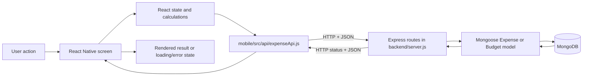

# Expense Tracker Learning Guide

This guide explains the implementation currently in this repository. It does not assume features or libraries that are absent from the code. The API routes below are described from their source; they have **not** been verified against a running MongoDB service.

## Table of contents

1. [Stage 1 — Inventory and architecture](#stage-1--inventory-and-architecture)
2. [Stage 2 — Mobile application](#stage-2--mobile-application)
3. [Stage 3 — Backend and data flow](#stage-3--backend-and-data-flow)
4. [Stage 4 — Dependencies and learning roadmap](#stage-4--dependencies-and-learning-roadmap)

---

## Stage 1 — Inventory and architecture

### What the app is made of

The mobile app is written in JavaScript with JSX. [Expo](https://expo.dev/) supplies the app tooling and entry point; [React Native](https://reactnative.dev/) supplies the mobile UI components and native rendering. React components and hooks hold the UI state. The app calls a JSON HTTP API using the built-in `fetch` function. An Express server receives those requests and uses Mongoose models to read and write MongoDB documents.

The main data path is:



For example, Add Transaction stores text input in component state, validates it, calls `createExpense`, and sends a POST request. Express reads JSON from `req.body`, Mongoose validates and stores a document, and the server returns the created document. When the app returns to Home, Home mounts again and fetches the expense list. This describes the code path; it does not prove that the configured server or database is reachable.

### Technology inventory

| Technology / Concept | Where It Is Used | Purpose | What I Need to Learn |
|---|---|---|---|
| JavaScript (ES modules) | `mobile/App.js`, `mobile/src/**`, `backend/server.js`, `backend/models/**` | Implements screens, request helpers, routes, and models | Values, functions, modules, promises, objects, and array methods |
| JSX | Mobile screens and `App.js` | Describes React component trees using JavaScript syntax | How JSX becomes React elements and why text needs `<Text>` in React Native |
| React 19 | `mobile/App.js` and all screens | Composes UI and rerenders it when state or props change | Components, props, state, and render cycles |
| React hooks | `useState`, `useEffect`, `useMemo`, `useCallback` in screens | Stores state, loads data, and memoizes derived values/functions | Hook rules, dependencies, stale values, and async effects |
| React Native 0.86 | Imports from `react-native` | Provides native UI primitives and styles | `View`, `Text`, `Pressable`, inputs, lists, Flexbox, and platform behavior |
| Expo SDK 57 | `mobile/index.js`, `app.json`, npm scripts | Runs the app in Expo Go/native builds and provides project tooling | Expo entry points, development server, app config, and Expo-compatible packages |
| Expo Status Bar package | Declared in `mobile/package.json` | A status-bar helper dependency; no source file currently imports it | Distinguish installed dependencies from dependencies actually used |
| Fetch, HTTP, JSON | `mobile/src/api/expenseApi.js` | Sends GET, POST, and DELETE requests and parses JSON responses | Promises, status codes, headers, JSON serialization, and network errors |
| REST-style API | `backend/server.js` | Exposes expense and budget collection routes | HTTP methods, route paths, request bodies, and response codes |
| Node.js | `backend/server.js` and models | Runs the backend JavaScript outside a browser | CommonJS modules, process environment, and server lifecycle |
| Express 4 | `backend/server.js` | Registers middleware and HTTP route handlers | Middleware order, `req`, `res`, async handlers, and status codes |
| Mongoose 8 | `backend/models/**`, `backend/server.js` | Defines MongoDB document schemas and performs database operations | Schemas, models, validation, queries, and document persistence |
| MongoDB | Connection configured by backend environment | Stores expense and budget documents | Collections, documents, indexes, connection strings, and CRUD |
| CORS | `app.use(cors())` in backend | Allows cross-origin clients to call the API | Browser origin rules and why CORS is not authentication |
| dotenv | `require('dotenv').config()` in backend | Loads backend environment variables | `.env`, safe secret handling, and process environment |
| `Intl.NumberFormat` and date APIs | Currency utility and screens | Formats numbers and dates for display | Locale formatting and why display formatting is not currency conversion |
| npm / lockfiles | `mobile/package*.json`, `backend/package*.json` | Declares and pins dependency installation | Runtime versus development packages and reproducible installs |

There is **no TypeScript**, Expo Router, React Navigation, Redux, Context provider, AsyncStorage, icon package, chart package, or test framework in the current source/configuration. Some screens draw small bars using ordinary `View` elements. `.env` contents are intentionally not included here.

### Relevant project structure

```text
expense-tracker/
├── EXPENSE_TRACKER_LEARNING_GUIDE.md  # This guide
├── mobile/
│   ├── App.js                         # App-level screen and currency state
│   ├── index.js                       # Expo root registration
│   ├── app.json                       # Expo app metadata and platform icons
│   ├── package.json                   # Mobile dependencies and Expo scripts
│   ├── package-lock.json              # Exact npm dependency resolution
│   ├── AGENTS.md                      # Mobile project instructions for coding agents
│   ├── assets/                        # App, Android adaptive, and web icons
│   └── src/
│       ├── api/expenseApi.js           # HTTP helpers for expenses and budgets
│       ├── components/
│       │   ├── ExpenseCard.js         # Older card with a delete callback; unused
│       │   └── ExpenseForm.js         # Empty file; unused
│       ├── constants/
│       │   ├── config.js              # API endpoint, with env override
│       │   └── currency.js            # Currency labels and number formatting
│       └── screens/
│           ├── HomeScreen.js          # Dashboard and expense summary
│           ├── AddTransactionScreen.js# Income/expense form
│           ├── TransactionsScreen.js  # Filtered list and details modal
│           ├── ReportsScreen.js       # Current-month totals and category bars
│           ├── BudgetsScreen.js       # Monthly limits, spent, and remaining
│           └── SettingsScreen.js      # Session-only currency display choice
└── backend/
    ├── server.js                      # Express setup, middleware, routes, DB startup
    ├── package.json                   # Backend runtime/dev dependencies and scripts
    ├── package-lock.json              # Exact npm dependency resolution
    └── models/
        ├── Expense.js                 # Expense/income transaction schema
        └── Budget.js                  # Category budget schema
```

`mobile/node_modules`, `backend/node_modules`, and `mobile/.expo` are generated or cached directories and are not source architecture. The mobile `.env` and backend `.env` are configuration files and may hold private values; do not paste their contents into logs or documentation. The backend also has an `.env.example` template. The mobile assets are configuration/runtime assets, not application logic.

### File responsibilities and connections

| File | Responsibility and connections | Status |
|---|---|---|
| `mobile/index.js` | Imports `App` and calls Expo's `registerRootComponent`, which registers the app root for Expo/native execution | Essential entry point |
| `mobile/App.js` | Owns the current screen name and selected currency. It renders one screen branch and passes callbacks/props down | Essential, custom routing |
| `mobile/app.json` | Sets Expo app name, slug, version, orientation, UI style, and icon paths | Expo configuration |
| `mobile/src/screens/HomeScreen.js` | Calls `getExpenses`; derives current-month income/expenses, weekly spending, top categories, and recent records; navigates by calling a prop | Main dashboard |
| `mobile/src/screens/AddTransactionScreen.js` | Owns form values and validation; calls `createExpense`; calls a parent callback after saving | Transaction creation |
| `mobile/src/screens/TransactionsScreen.js` | Calls `getExpenses`; filters/sorts the results locally; opens a details `Modal` | Transaction history/details |
| `mobile/src/screens/ReportsScreen.js` | Calls `getExpenses`; derives current-month income, expenses, net change, and category totals | Analytics |
| `mobile/src/screens/BudgetsScreen.js` | Loads budgets and expenses; saves a monthly limit; derives spent/remaining from expense records | Budget UI |
| `mobile/src/screens/SettingsScreen.js` | Shows currency options and an account-not-configured note; selection is passed back to `App.js` | Preferences UI |
| `mobile/src/api/expenseApi.js` | Centralizes fetch calls and response parsing; used by screens | API helper |
| `mobile/src/constants/config.js` | Uses `EXPO_PUBLIC_API_URL` if set; otherwise defaults to the Android emulator URL ending in `/api/expenses` | Runtime configuration |
| `mobile/src/constants/currency.js` | Defines supported display labels and number locales; imported by screens | Reusable formatter |
| `mobile/src/components/ExpenseCard.js` | Displays an expense and calls `onDelete` when pressed | Unused legacy component; no screen imports it |
| `mobile/src/components/ExpenseForm.js` | Contains no code (0 bytes) | Empty, unused file |
| `backend/server.js` | Loads environment settings; installs middleware; registers routes; connects Mongoose before listening | Backend entry point and route/controller code combined |
| `backend/models/Expense.js` | Defines title, amount, type, category, date, notes, and timestamps | Essential transaction schema |
| `backend/models/Budget.js` | Defines a unique, lowercase category and positive amount with timestamps | Essential budget schema |
| `package.json` files | Declare dependencies and commands | Configuration |
| `package-lock.json` files | Record exact dependency tree versions | Generated dependency lockfiles |

The API helper is centralized, but screen-specific calculations live in each screen. The backend has no separate controllers or service layer. `ExpenseForm.js` and `ExpenseCard.js` look like leftovers from an earlier UI: neither is connected to current screens. `deleteExpense` and the backend delete route are also not used by `TransactionsScreen`.

### Feature status from source inspection

| Feature | Status | Evidence / limitation |
|---|---|---|
| Home dashboard | Implemented against expense GET endpoint | API-backed totals, category summary, seven-day spending bars, and four recent items; no server-side aggregation |
| Add income/expense | Implemented in source | Form validation and POST helper; actual DB write has not been verified |
| Transaction list | Implemented in source | Local all/expense/income filters, date sorting, details modal; no edit/delete controls |
| Reports | Implemented in source | Current-month totals/net and category breakdown derived from fetched transactions |
| Budgets | Implemented in source | Mongo model and GET/POST upsert routes; monthly spent amounts are derived client-side |
| Settings/currency | Partially implemented | Changes labels/number locale while app is open; amounts are not converted and choice is not persisted |
| Theme | Missing | No theme preference/provider; app configuration is light mode |
| Authentication/accounts | Missing | No user model, login, registration, token handling, or account routes |
| Data ownership | Missing | API routes have no user identity or authorization; all clients share the same configured database data |
| API reachability | Not verified | Source routes exist, but no successful live endpoint/database test is established |
| Navigation | Implemented minimally | `App.js` conditionally renders a screen based on string state; no stack/tabs/history/deep links |
| Testing/linting | Missing/unverified | No test script, TypeScript files, or local ESLint binary/config are present; previous Expo checks hit environment errors |

### Concepts found for the following stages

The mobile source uses component composition, props, `useState`, `useEffect`, `useCallback`, `useMemo`, controlled inputs, callbacks, conditional JSX, list mapping/keys, filtering, sorting, reducing, spread syntax, optional chaining, template strings, `async`/`await`, `try`/`catch`/`finally`, `fetch`, JSON, `FlatList`, `ScrollView`, `Modal`, `Pressable`, `TextInput`, Flexbox, and `StyleSheet.create`. The backend uses CommonJS modules, Express middleware, route parameters/body data, async handlers, Mongoose schemas/models, validation, queries, and environment configuration. These are explained with project examples in Stages 2 and 3.

---

## Stage 2 — Mobile application

### 2.1 How the mobile app starts

The mobile package names index.js as its main entry. [index.js](mobile/index.js#L1) imports Expo's registerRootComponent and the app component, then registers it. Registration connects the JavaScript root to the Expo/native runtime. [App.js](mobile/App.js#L9) is the root React component and selects a screen.

This project uses JavaScript, not TypeScript. JSX is the markup-like syntax inside JavaScript functions, such as <HomeScreen currency={currency} />. Expo tooling transforms JSX and modern JavaScript for the app runtime. An uppercase JSX tag refers to a component. A lowercase HTML tag would refer to a web element in React for web, but this app uses React Native components imported from react-native.

### 2.2 Components, props, and navigation

A component is a function that returns part of the UI. HomeScreen, TransactionsScreen, and BudgetCard are examples. Components compose other components: screens contain headers, cards, rows, and inputs. Small display components such as MetricCard, TransactionRow, DetailLine, BudgetCard, and SectionHeader keep repeated display responsibilities separate.

The app does not use React Navigation or Expo Router. [App.js](mobile/App.js#L9) owns screen and conditionally returns one screen. Home receives an object with a custom navigate function. This simple switcher has no navigation stack, OS back handling, route parameters, deep links, or tabs.

~~~jsx
const [screen, setScreen] = useState('Home');
if (screen === 'Transactions') {
  return <TransactionsScreen currency={currency} onBack={() => setScreen('Home')} />;
}
~~~

- useState('Home') creates the current screen value and its setter.
- setScreen('Transactions') asks React to render App again; the if branch then returns a different component.
- currency and onBack are props: values/functions passed from parent to child.
- The inline arrow function is a callback. The child calls it when its back button is pressed.
- If a route name is misspelled or not allowed in App, the screen will not switch.

App also owns currency and passes it to screens that format amounts. This is lifting state up: shared state lives in the nearest common parent. Settings calls the parent's onCurrencyChange callback, so the display changes across screens while the app is running. The choice is not saved to device storage and resets to PKR after reload.

**Try it:** Temporarily add console.log(name) to App's navigate function, press “View all transactions,” then remove the log. Follow the callback from Home to App state.

### 2.3 State, props, and effects

React state is data a component can change. Calling a state setter asks React to rerender. [AddTransactionScreen.js](mobile/src/screens/AddTransactionScreen.js#L29) stores form values. [TransactionsScreen.js](mobile/src/screens/TransactionsScreen.js#L52) stores downloaded rows, selected filter, selected detail row, loading, and error state.

~~~
const [amount, setAmount] = useState('');
~~~

Array destructuring reads the current value and setter from the pair returned by useState. The initial value is an empty string because text inputs edit strings naturally. Assigning amount = nextValue would only change a local variable and would not ask React to rerender. State updates are scheduled; do not expect a setter to synchronously replace the value inside the same handler.

useEffect connects rendering with an outside action. Data screens load from the API when mounted:

~~~
const loadTransactions = useCallback(async () => { /* fetch and set state */ }, []);
useEffect(() => { loadTransactions(); }, [loadTransactions]);
~~~

The effect dependency list contains the function it calls. useCallback keeps that function reference stable while its own dependencies do not change. Here the callback reads no changing component values, so its list is empty. Without a stable callback, depending on a new function created on every render could repeatedly rerun the effect. useCallback stabilizes the function reference; it does not speed up the network request.

useMemo caches calculations until its listed values change. Transactions uses it for filtering/sorting; Reports and Budgets use it for derived monthly/group data. It is not persistent state. useRef, class components, reducers, custom hooks, and Context are absent.

**Common mistakes:** leaving a changing value out of an effect dependency list can produce stale results; adding freshly created dependencies can rerun an effect too often; storing a calculated total separately from the records can let them disagree.

### 2.4 Controlled forms and validation

A controlled input gets its value from React state. In [AddTransactionScreen.js](mobile/src/screens/AddTransactionScreen.js#L29), each TextInput has a value property and an onChangeText handler.

~~~
<TextInput value={amount}
  onChangeText={(value) => setAmount(value.replace(',', '.'))}
  keyboardType="decimal-pad" />
~~~

value renders the current state. onChangeText receives the string the user typed. setAmount stores it, and React renders the new string. Replacing a comma with a period is an input convenience; keyboardType only requests a decimal keyboard and does not validate input.

The submit handler converts amount with Number, checks it is finite and greater than zero, trims text fields, and validates the date as YYYY-MM-DD including a round-trip through Date. Then it calls createExpense. Text is kept as a string until conversion because text controls naturally edit strings.

Notes are optional and capped with maxLength. Description and category are required. Date is typed manually; no date picker library is installed. Validation errors are conditionally rendered in a Text component. The selected currency changes the visible label only; no exchange-rate conversion exists.

**Try it:** Temporarily change the amount validation to allow zero, observe the difference, and restore the original greater-than-zero condition.

### 2.5 Async requests, loading, and errors

An async function returns a Promise. await pauses that function until the Promise settles without freezing the entire UI. Screens set loading before a request and clear it in finally, so the spinner disappears after both success and failure.

~~~
try {
  const result = await getExpenses();
  if (!Array.isArray(result)) throw new Error('Unexpected transaction data');
  setTransactions(result);
} catch (loadError) {
  setError(loadError.message || 'Could not load transactions.');
} finally {
  setLoading(false);
}
~~~

try contains work that can fail. throw creates a failure if the response has an unexpected shape. catch converts failure into UI state. finally always runs. Each screen renders loading, error/retry, empty, or data UI with conditional JSX. Retrying calls the same loader again. There is no request cancellation, timeout, or offline cache.

### 2.6 Arrays and calculations

The app uses array methods to transform API data:

| Method | Meaning | Actual use |
|---|---|---|
| map | Convert each item to another value or UI element | Render rows/options and construct category summaries |
| filter | Keep matching items | Current month, income/expense, selected transaction filter |
| find | Return the first match | Find currency metadata for a currency code |
| reduce | Accumulate one total or grouped object | Sum amounts and group spending by category/day |
| sort | Reorder an array | Newest transactions and largest category totals |
| slice | Copy part of an array | Four recent transactions and three Home categories |
| forEach | Visit items for side effects | Not used in mobile source |

From Home:

~~~
const monthlyExpenses = monthExpenses
  .filter((item) => item.type !== 'income')
  .reduce((sum, item) => sum + (Number(item.amount) || 0), 0);
~~~

filter keeps expenses, including records with an absent type. reduce starts at zero and adds each amount. Number converts a possible string to a number; || 0 is a fallback. A beginner trap is adding a numeric string directly: '10' + 2 becomes '102', not 12.

Transactions filters into a new array and sorts that copy in useMemo. Calling sort directly on the state array would mutate it; mutating React state in place can prevent reliable rerendering.

### 2.7 JSX, conditions, callbacks, and JavaScript syntax

Curly braces inside JSX evaluate JavaScript. A ternary expression chooses between two values; && conditionally includes content. Screens use these for loading/error/data branches and income/expense styling.

items.map((item) => <Row key={item.id} item={item} />) passes a function into map, so map is a higher-order function. key gives React a stable identity for sibling rows. Use MongoDB _id where available; indexes may be unstable when a list is reordered.

This code uses const/let bindings, strings, numbers, booleans, arrays, objects, named and arrow functions, imports/exports, destructuring, spread syntax, optional chaining, default parameters, template strings, callbacks, and try/catch/finally. For example, [...expenses] makes a shallow copy, and onSaved?.() calls a callback only when present. The nullish coalescing operator is not used. Template strings use backticks and a dollar sign plus braces around an expression to put a computed value inside text; accessibility labels and currency formatting use this pattern.

Props such as onBack, onTransactions, and onCurrencyChange are callbacks. The child reports an action; the parent decides how to change screen/state. This avoids making each screen own app-wide navigation or currency state.

### 2.8 React Native components and layout

| Component | Role in this app |
|---|---|
| SafeAreaView | Keeps screen content within device safe areas |
| View | General layout container |
| Text | All visible text; React Native does not allow bare text directly in View |
| ScrollView | Scrollable Home, form, report, budget, and settings content |
| FlatList | Virtualized transaction rows |
| Pressable | Buttons, filter choices, list rows, and currency options |
| TextInput | Controlled transaction and budget forms |
| Modal | Transaction detail overlay |
| ActivityIndicator | Loading spinner |
| StatusBar | Status-bar foreground and background presentation |

StyleSheet.create groups style objects. Styles resemble CSS ideas but use JavaScript camelCase names such as backgroundColor and fontSize, numeric density-independent units, and no stylesheet file. Flexbox properties include flexDirection, justifyContent, alignItems, flex, gap, and padding. Screens repeat local COLORS objects; there is no shared theme provider.

There is no TouchableOpacity, image component in screen code, icon package, chart package, or KeyboardAvoidingView. Arrows are text glyphs; the weekly/category charts are simple View bars. ScrollView renders all children at once; FlatList is a better fit for a potentially long transaction list. Some Pressable controls have accessibility labels/roles and selected state, but coverage is not complete. Add Transaction sets keyboardShouldPersistTaps, but no separate keyboard-avoidance layout.

### 2.9 What each mobile screen calculates

- **Home:** fetches all expenses; filters the current month; reduces income/expense totals; groups categories; calculates seven daily expense values; sorts and slices four recent records. The chart is calculated on the device.
- **Add Transaction:** holds one state value per field. After validation it POSTs a record. On success, App switches back to Home, which mounts and fetches again.
- **Transactions:** loads the same expense endpoint, filters and sorts locally, and opens a Modal for details. It has no edit/delete buttons even though an API delete helper exists.
- **Reports:** fetches the same list and derives current-month income, expenses, net change, and category totals.
- **Budgets:** sends budget and expense GET requests concurrently with Promise.all. It totals monthly expenses by normalized category, and POSTs a budget limit before reloading.
- **Settings:** sends the selected currency code to App through a prop callback. It is session-only; no account flow exists.

### 2.10 Practice and debugging

1. Follow a button from onPress to its callback and then to the state setter it calls.
2. Follow an input from value to its useState declaration and from onChangeText to the setter.
3. Put a temporary console.log before and after await to observe asynchronous control flow.
4. Practice filter, reduce, sort, and map on a small fixture array in a scratch file.
5. When UI is blank, inspect loading, error, and list length before editing styles.
6. When React warns about list keys, inspect the list key or FlatList keyExtractor.

---

## Stage 3 — Backend and data flow

### 3.1 Node modules and server startup

The backend uses Node.js and CommonJS modules. [backend/server.js](backend/server.js#L1) imports packages with require(...); model files expose their Mongoose model using module.exports. This differs from the mobile app's ES module import/export syntax.

The startup order is:

1. require('dotenv').config() reads backend environment settings into process.env.
2. Express, CORS, and JSON middleware are registered.
3. Route handlers are registered.
4. startServer checks for MONGODB_URI and attempts mongoose.connect.
5. Only after the MongoDB connection succeeds does app.listen start the HTTP server.

The port is process.env.PORT or 5000. The URI and any real environment values are private configuration and are intentionally not included here. If the URI is missing or MongoDB connection fails, the process logs an error and exits with code 1. A source route existing does not mean the service successfully starts.

### 3.2 Express middleware and request handling

Express is the HTTP server framework. Middleware is a function run as a request travels through the app. In server.js, cors() is registered before express.json(). The first permits cross-origin requests under the middleware's defaults; the second parses JSON request bodies and makes them available on req.body. Routes follow those middleware registrations.

A route matches an HTTP method and path, for example app.post('/api/expenses', handler). The handler gets req (request) and res (response). In this project:

- req.body supplies submitted expense or budget fields.
- req.params.id supplies the ID segment in DELETE /api/expenses/:id.
- req.query is not read by any route.
- res.status(code).json(value) sets an HTTP status and serializes JSON.

Route handlers are inline in server.js; there is no separate controller or router folder. Each async handler uses try/catch. Errors generally return a short message to the client and log the specific message server-side. There is no shared async error middleware.

### 3.3 Mongoose models and stored data

Mongoose is an object/document modeling library over MongoDB. A Schema describes fields and validation; model() creates the object used to query a MongoDB collection. The collection stores documents, roughly like JSON records.

**Expense** — [Expense.js](backend/models/Expense.js#L3)

| Field | Schema rule | Meaning |
|---|---|---|
| title | Required string, trimmed | Description |
| amount | Required number, minimum 0 | Positive magnitude; direction comes from type |
| type | expense or income; defaults to expense | Transaction direction |
| category | String, trimmed, defaults to General | Category label |
| date | Date, defaults to current time | Transaction date |
| notes | Trimmed string, defaults to empty | Optional note |
| timestamps | Added by schema option | Mongoose-managed createdAt/updatedAt |

**Budget** — [Budget.js](backend/models/Budget.js#L3)

| Field | Schema rule | Meaning |
|---|---|---|
| category | Required, trimmed, lowercased, unique | One saved budget per normalized category |
| amount | Required number, minimum 0.01 | Monthly limit |
| timestamps | Added by schema option | Mongoose-managed createdAt/updatedAt |

Mongoose applies schema validation when creating/updating through its model operations. The expense route relies on this for required title, numeric amount, and enum type. The budget route performs some request checks before calling Mongoose. A unique field typically creates/uses a MongoDB unique index; duplicate/index behavior should be checked against a real database before relying on it in production.

### 3.4 Every API endpoint in source

All listed routes are **source-inspected only**. There is no successful live API/MongoDB verification established.

| Method and path | Request | Source behavior and response | Mobile caller | Verification |
|---|---|---|---|---|
| GET / | No parameters/body | Returns plain text “Expense API running” | None in mobile | Route exists; not live-tested |
| GET /api/expenses | No query parameters | Expense.find().sort({date:-1}); responds 200 with an array of expense documents; database error responds 500 with a message object | Home, Transactions, Reports, Budgets | Route exists; not live-tested |
| POST /api/expenses | JSON: title, amount, optionally type, category, date, notes | Expense.create(...); 201 with created document; Mongoose validation error 400; other error 500 | AddTransaction via createExpense | Route exists; not live-tested |
| DELETE /api/expenses/:id | ID in URL path | findByIdAndDelete; 200 with a message if found; 404 if absent; 400 for invalid Mongo ID; 500 for other error | No current screen. deleteExpense helper exists but is not called | Route exists; not live-tested |
| GET /api/budgets | No query parameters | Budget.find().sort({category:1}); 200 with array; database error 500 | Budgets | Route exists; not live-tested |
| POST /api/budgets | JSON: category, amount | Trims/lowercases category, converts amount to Number, rejects blank/invalid/nonpositive with 400, then findOneAndUpdate with upsert; 200 with created/updated budget; validation error 400, other error 500 | Budgets via saveBudget | Route exists; not live-tested |

These are **illustrative schema-derived shapes**, not captured responses from a running server. A successful GET expenses response is an array of documents; a POST expense response is one document. The document fields come from Expense.js, and timestamps/_id are supplied by MongoDB/Mongoose:

~~~json
[
  {
    "_id": "MongoDB-generated id",
    "title": "Groceries",
    "amount": 2500,
    "type": "expense",
    "category": "Food",
    "date": "2026-10-14T00:00:00.000Z",
    "notes": "",
    "createdAt": "MongoDB-generated timestamp",
    "updatedAt": "MongoDB-generated timestamp"
  }
]
~~~

GET budgets similarly returns an array of documents with category, amount, id, and timestamps. POST budgets returns one document. Error responses in routes use an object with a message string; DELETE success also returns a message object. Example values above are teaching examples, not actual database records.

There are no PUT or PATCH endpoints. POST /api/budgets acts as an upsert (create if missing, update if present), which is why its success status is 200 rather than the 201 used when a new expense is created. There is no pagination, server-side filtering, search, account scoping, or server-side report aggregation.

### 3.5 How the API helper works

[expenseApi.js](mobile/src/api/expenseApi.js#L1) keeps URL and fetch details out of screens. handleResponse tries to parse JSON. If the status is not successful, it throws an Error using a server message when available. Each exported helper calls fetch with the route and HTTP method; POST adds a JSON content type and JSON.stringify body.

For budgets the helper derives /api/budgets by replacing the /expenses suffix on API_URL. This assumes EXPO_PUBLIC_API_URL is the full expenses endpoint, not just the API base. If that setting points elsewhere or does not end in /expenses, the derived URL may be wrong.

Network failures reject fetch before handleResponse can parse a body. The calling screen catches that rejection and sets an error message. The app checks that GET results are arrays but does not validate each document's fields.

### 3.6 End-to-end user flows

#### Dashboard load

1. App selects HomeScreen.
2. Home's useEffect calls its stable loadExpenses callback.
3. loadExpenses sets loading, calls getExpenses, and checks for an array.
4. The API helper sends GET to API_URL.
5. Express routes to Expense.find, sorted newest first.
6. The response array is stored in Home state.
7. Home filters records by the current local month; it treats any non-income record as expense.
8. reduce adds amounts; category grouping makes an object; sort/map build top categories and recent rows.
9. JSX renders cards, bars, or loading/error/empty messages.

#### Add income or expense

1. The user types title, amount, category, date, and optional notes in controlled TextInputs and chooses a type.
2. Each onChangeText calls a state setter.
3. Pressing Save calls submit.
4. Client checks required fields, positive finite amount, and a valid YYYY-MM-DD date.
5. createExpense serializes the form object to JSON and sends POST /api/expenses.
6. Express JSON middleware parses it into req.body.
7. The route passes its fields to Expense.create. Mongoose validates fields and persists a document.
8. The route sends status 201 and the created document.
9. The mobile helper parses it; the screen does not use the returned document, only success/failure.
10. On success the screen invokes onSaved. App sets the active screen to Home; Home mounts and performs another GET.

The last steps make the new item appear after a successful save if the API/database works. There is no shared client cache that updates the other screens immediately.

#### Transactions list and details

1. TransactionsScreen fetches the entire expense array.
2. A local filter keeps all/expense/income records; missing type is treated as expense.
3. The UI sorts by date newest-first and renders with FlatList.
4. Pressing a row stores that record in selected state.
5. A Modal appears and reads type/category/date/notes from the selected object.

No edit or delete button is connected. DELETE exists in the helper/server only; the old ExpenseCard is not imported by this screen.

#### Reports

ReportsScreen fetches the same array and filters it to the current local month. It calculates income minus expenses locally and groups expense amounts by category. These are client calculations, not a report endpoint or chart library.

#### Budgets

BudgetsScreen calls getBudgets and getExpenses at the same time with Promise.all. It filters current-month expenses (not income), normalizes category text, and totals matching spend against each budget amount. The user submits a category and monthly limit; saveBudget sends POST /api/budgets, where findOneAndUpdate with upsert stores or updates it. The screen reloads the budget and expense arrays after a successful save.

#### Settings

Settings is local UI state only. Selecting a currency calls setCurrency in App. Screens use currency.js to change label and number locale; values are not converted. The choice is lost when the JavaScript app process is restarted. There is no settings API or local storage dependency.

### 3.7 Backend security and correctness limits

- There is no authentication or authorization. No user ID is attached to documents or queries, so all clients using this database see the same data.
- CORS uses defaults allowing broad cross-origin use; CORS is not a security boundary and does not authenticate users.
- The server accepts JSON but has no request-size policy, rate limit, or global input-validation middleware.
- Expense input validation is mostly Mongoose schema validation. Budget input has explicit category/amount checks.
- There is no centralized error middleware, transaction, audit log, or structured logger.
- API routes hide most internal errors from the response, which helps avoid exposing internals, but diagnostics depend on server logs.
- All records are fetched and calculations are made on the mobile device; large datasets will become slow and consume more memory.
- Account isolation, API reachability, production security, and actual persistence need separate verification before treating this as production-ready.

---

## Stage 4 — Dependencies and learning roadmap

### 4.1 Dependencies and what they do

#### Mobile runtime dependencies

| Package | Declared version | Use found in source | Assessment |
|---|---:|---|---|
| expo | ~57.0.28 | Expo entry registration in index.js; development/build tooling | Runtime/framework package |
| react | 19.2.3 | JSX component and hook implementation | Runtime dependency |
| react-native | 0.86.3 | Screen and native component imports | Runtime dependency |
| expo-status-bar | ~57.0.1 | No import found; screens import StatusBar from react-native | Appears unused directly |

The Expo SDK reference associates SDK 57 with React Native 0.86 and React 19.2.3, matching package.json. See [Expo SDK reference](https://docs.expo.dev/versions/v57.0.0/). Expo is the project/runtime tooling layer; React Native is the UI layer that renders platform-native controls. React is the component/state layer used by React Native.

#### Mobile development dependency

| Package | Declared version | Use found in source | Assessment |
|---|---:|---|---|
| @react-native-community/cli | ^20.2.0 | Not imported by app source or directly named in scripts | Development/native tooling dependency |

#### Backend dependencies

| Package | Declared version | Use | Runtime/development |
|---|---:|---|---|
| express | ^4.19.2 | HTTP app, middleware, and routes | Runtime |
| mongoose | ^8.5.0 | MongoDB connection, schemas, models, queries | Runtime |
| cors | ^2.8.5 | Cross-origin middleware | Runtime |
| dotenv | ^16.4.5 | Loads backend environment values | Runtime |
| nodemon | ^3.1.4 | Restarts server during development | Development only |

The package-lock files record the resolved dependency tree so installs use reproducible versions. They are not intended to be read line by line. There are no app-level icon/chart, routing, storage, date picker, form, or HTTP client packages. fetch comes from the JavaScript runtime.

### 4.2 Scripts and configuration

**Mobile scripts** in mobile/package.json:

- npm start runs Expo's development server.
- npm run android starts Expo targeting Android.
- npm run ios targets iOS.
- npm run web targets web.

The project instructions in mobile/AGENTS.md say to run Expo commands from the mobile folder and use Expo-compatible installation commands. They recommend Expo Router, but the actual package and source do not include Expo Router: current navigation is the custom screen switcher described above.

**Backend scripts** in backend/package.json:

- npm start runs node server.js.
- npm run dev runs nodemon server.js for development restart behavior.

Run each command from its own folder. The server defaults to port 5000 and reads PORT as an override. It needs MONGODB_URI before listening.

**app.json** configures the app name/slug/version, portrait orientation, light UI, icon files, iOS tablet support, Android adaptive icons, and web favicon. Icons are image assets; no screen currently imports an image or icon package.

**API configuration** is in [config.js](mobile/src/constants/config.js#L1). EXPO_PUBLIC_API_URL overrides the fallback URL, which targets 10.0.2.2:5000 for the Android emulator and includes /api/expenses. This setting is client-visible by design; do not put secrets in EXPO_PUBLIC variables. The backend's MONGODB_URI must remain server-side. The budget helper derives the sibling /api/budgets path from the configured expenses URL.

There is no TypeScript config, custom Babel config, ESLint config, test script, or type-check script. A prior source-level check found that Expo lint/start attempts encountered EACCES, and a Babel transform attempt could not resolve babel-preset-expo. Babel parser syntax checks had succeeded for inspected files, but those checks do not prove Metro bundling, UI rendering, HTTP behavior, or MongoDB persistence.

### 4.3 Architecture and trade-offs

The separation is lightweight:

- Screens own screen state, data loading, calculations, and most UI.
- expenseApi.js owns request details and response parsing.
- constants/config.js owns the API URL.
- constants/currency.js owns currency labels and number formatting.
- backend/server.js owns Express setup and route logic.
- backend/models contains database schemas.

This is easy to follow for a small learning app. It also means screens repeat loading/error patterns and fetch the entire transaction collection independently. No shared query cache, repository layer, custom hooks, or centralized theme exists. A backend controller/service split and shared data hooks could reduce repetition later, but they are not present now.

The project uses imperative route strings and conditional rendering rather than a navigation library. Simple, but routes and callbacks are hand-maintained. Parent state for currency is shared by props, which is clear for a handful of screens. It does not persist after restart.

Calculations are duplicated across Home, Reports, and Budgets. They use local dates and client-side data. For larger datasets, server-side filtering/pagination/report queries would be more efficient and reduce client work, but add API complexity. Do not assume a server aggregation endpoint exists.

### 4.4 Concept checklist

“Used and understood” below means the guide has explained the concept; it does not claim the learner has mastered it yet.

#### Used and understood — foundational

- [ ] JavaScript values, strings, numbers, booleans, arrays, objects, const bindings, and scope
- [ ] Named/default imports and exports; CommonJS require/module.exports
- [ ] Functions, arrow functions, parameters, return values, callbacks
- [ ] JSX, components, composition, props, conditional rendering
- [ ] React useState, rerendering, controlled TextInput fields
- [ ] Press events and passing callbacks from parent to child
- [ ] React Native View, Text, Pressable, ScrollView, SafeAreaView, FlatList, Modal
- [ ] StyleSheet.create and Flexbox layout
- [ ] Arrays with map, filter, find, reduce, sort, and slice
- [ ] Loading, error, empty, and data rendering branches

#### Used but needs practice — intermediate

- [ ] useEffect dependencies and mount-time API loading
- [ ] useCallback and useMemo dependency lists
- [ ] Async functions, Promises, await, try/catch/finally
- [ ] HTTP methods, status codes, JSON request/response parsing
- [ ] Data validation on both mobile and Mongoose sides
- [ ] Shallow copies, immutability, stable React keys
- [ ] Date parsing, local-month boundaries, locale formatting, timezone effects
- [ ] Expense/income signs, category aggregation, budget remaining/overspending calculations
- [ ] Custom screen switching, lifted state, prop callbacks
- [ ] MongoDB schemas, Mongoose model queries, upserts, and unique indexes
- [ ] CORS and the difference between cross-origin access and user authentication

#### Important but missing or incomplete

- [ ] A real navigation library/stack, hardware-back behavior, tabs, and route parameters
- [ ] Persistent settings storage; the current currency choice is session-only
- [ ] Currency conversion; current settings change only the label and number locale
- [ ] Theme preference; only light styling is implemented
- [ ] Authentication, authorization, user-specific records, and account management
- [ ] Transaction edit UI/API and delete UI, despite one delete API/helper existing
- [ ] Date picker and fuller keyboard/safe-area handling for forms
- [ ] Automated unit/integration/UI tests, configured lint, and type checking
- [ ] Verified Expo launch, API connectivity, and MongoDB persistence
- [ ] Pagination/search or server-side summaries for larger datasets
- [ ] More complete API validation, rate limiting, and production security configuration
- [ ] Nonempty ExpenseForm component; ExpenseCard is unused legacy code

### 4.5 Suggested learning order

1. **JavaScript foundations:** objects, arrays, functions, imports/exports, types, and scope. Practice with currency.js and simple transaction records.
2. **Array transformations:** reproduce the Home monthly total with filter and reduce; then group categories into an object.
3. **React and JSX:** read App.js, identify every component, prop, callback, and conditional render.
4. **State and inputs:** follow AddTransactionScreen from each TextInput through validation and submit.
5. **React Native layout:** inspect one screen's StyleSheet; change padding, flexDirection, and alignment and observe the result.
6. **Promises and HTTP:** trace getExpenses through fetch, response parsing, loading, and error states.
7. **Express:** read middleware order and each route; identify req data and status/response paths.
8. **MongoDB/Mongoose:** understand Expense and Budget schemas, validation, sorting, and budget upsert.
9. **Full feature traces:** walk Add Transaction, Transactions, Reports, then Budgets from screen to database and back.
10. **Missing production concepts:** tests, navigation stack, persistence, authentication/data ownership, API security, and pagination.

### 4.6 Short architecture summary

Expo starts the JavaScript app. React components and React Native controls render the interface. App.js selects one screen at a time and shares a temporary currency preference. Screens call a small fetch helper. The Express server parses JSON and routes requests to Mongoose. Mongoose validates and reads/writes Expense or Budget documents in MongoDB. Home, Transactions, Reports, and Budgets calculate most display summaries on the device.

The app source provides a useful learning path through forms, UI state, REST requests, validation, database schemas, and data aggregation. The most important gaps to keep in mind are that API routes have not been live-verified, user accounts/data isolation do not exist, settings do not persist, and editing/deleting transactions is not connected to the UI.
